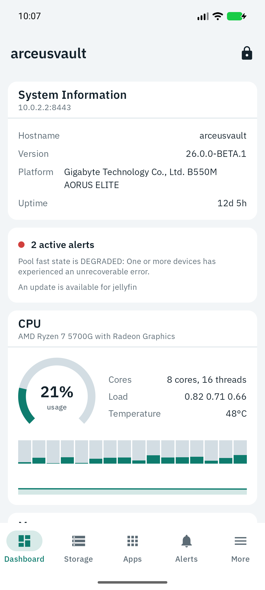
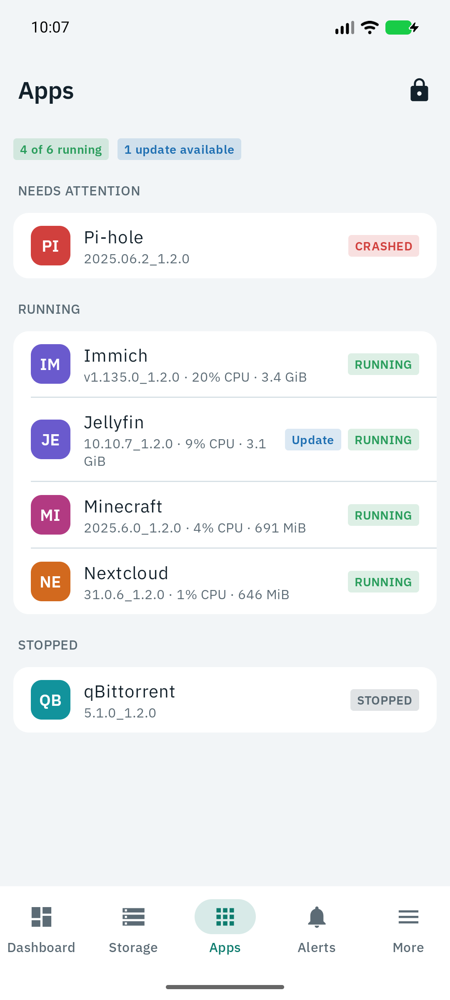
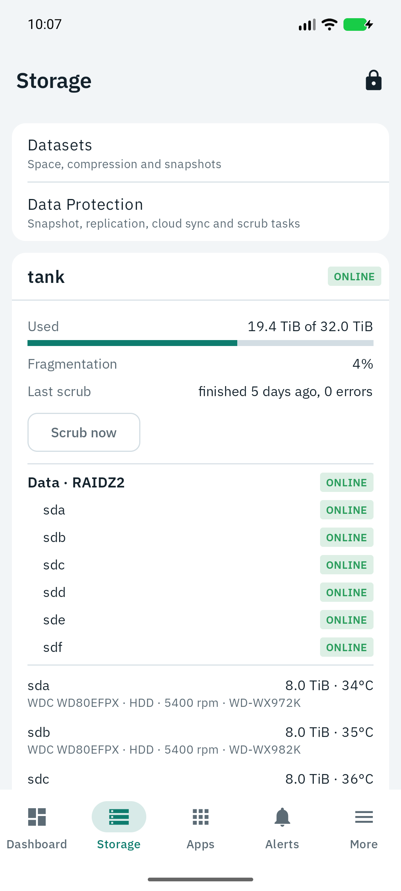
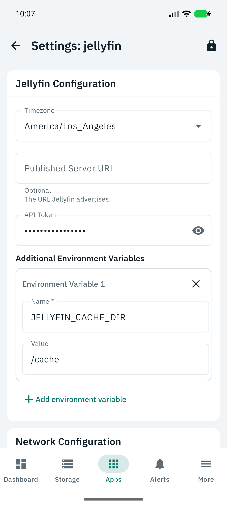

<div align="center">


# Keel

### A mobile client for TrueNAS

**Check on your NAS, restart an app, run a backup or roll back a snapshot, from your phone.**

[](https://github.com/ah410/keel/actions/workflows/ci.yml)
[](https://github.com/ah410/keel/releases/latest)
[](LICENSE)
[](#install)
[](#building)
[](https://www.anthropic.com/claude)
[](PRIVACY.md)

[Install](#install) · [Features](#features) · [Security](#how-it-protects-your-server) · [Server setup](#setting-up-your-server) · [Building](#building) · [Privacy](PRIVACY.md)

</div>

<br />

<p align="center">
  
  
  
  
</p>

Keel is a native Android app for TrueNAS Community Edition (SCALE), built and tested against 26.0. It talks to your
server's own JSON-RPC API, needs nothing installed on the NAS, and makes no network connections
other than to your server. There are no analytics, ads, crash reporters or Google Play services.

Inspired by the recent explosion of AI-assisted video game decompilations and open source clones of
Adobe apps, I decided to try it myself by building an app to monitor and configure my TrueNAS
server from my phone. Keel is the result: it was built with Claude Opus 5.5 in Claude Code, with me
directing the work and testing it against my own server.

Keel is an independent project. It is not affiliated with, endorsed by or sponsored by TrueNAS or
iXsystems. TrueNAS® is a registered trademark of iXsystems, Inc., used here only to say what Keel
works with.

## Install

Download the APK from the [latest release](https://github.com/ah410/keel/releases/latest), or add
this repository to [Obtainium](https://github.com/ImranR98/Obtainium) to get updates. Release
builds are reproducible and signed with this certificate:

```
SHA-256: 47:BA:2B:A3:EA:64:C6:EF:9B:53:26:73:25:C5:CE:B1:AC:95:96:5F:AE:C9:19:87:BD:6F:E2:D5:EA:60:3E:DA
```

To look around before setting anything up, tap "Try a demo server" on the first screen. It runs
the whole app on built-in sample data, makes no network connections and forgets your changes when
you leave.

## Features

What Keel can change depends entirely on the API key you give it. TrueNAS keys carry roles, and the
app reads them at login and only shows the actions the key is allowed to perform. A key for a
Read-Only Administrator gives you a read-only app, and App Settings lists exactly what the current
key can do.

The dashboard shows live CPU, memory, network and pool health. Apps get a list with live usage,
start, stop, redeploy, upgrade with a version picker and changelog, rollback, configuration editing
and live container logs. Storage covers pools, datasets, snapshots (create, delete, roll back),
scrubs, and running snapshot, replication and cloud sync tasks. Alerts can be dismissed and
restored, and optional background notifications use a separate read-only key. The System tab has
services, updates, reboot and shutdown, reporting graphs, boot environments, network and the audit
log. VMs and LXC containers can be started and stopped, SMB and NFS shares can be created, edited
and toggled, and you can keep several servers and switch between them.

## How it protects your server

Your API key never leaves the phone. Login uses SCRAM-SHA-512, so the key isn't sent over the
wire and the server has to prove it holds the key too before the app trusts the session. After
the first login the app throws the raw key away and keeps only the derived SCRAM keys, which can't
be used with TrueNAS's plaintext key login. Those keys sit in a file encrypted with an AES-256-GCM
key in the Android Keystore (StrongBox when the phone has a secure element), and that Keystore key
only works for 30 seconds after you unlock with a strong biometric or your device PIN. Nothing
about a logged-in session survives the app locking, being killed, or the phone restarting.

TLS is always required. A publicly trusted certificate (for example Let's Encrypt behind a reverse
proxy) is verified the normal way, including the hostname. With TrueNAS's self-signed certificate
the app shows you its SHA-256 fingerprint on first connect and pins its public key once you
confirm it. From then on a different certificate is a hard stop with a warning, never a silent
re-trust. User-installed CAs are ignored.

Secure mode is the default and assumes you reach the server over your LAN or a VPN such as
Tailscale. In this mode the app refuses to connect if the hostname resolves to a public IP
address. Direct mode exists for people who already expose TrueNAS to the internet on purpose. It
sits behind a warning screen you have to acknowledge, and a "Direct" badge stays visible while
it's in use.

Every change to the server goes through a confirmation step that gets stricter with the damage it
can do. Dismissing an alert is one tap. Starting or stopping an app or service asks first. Deleting
a snapshot or share, upgrading an app, changing its settings or installing an update also needs
your fingerprint or PIN. Rolling a dataset back, rebooting and shutting down make you type the
dataset or hostname as well. Long-running actions are tracked as server jobs and keep going if you leave the screen;
the spinner in the top bar opens the task list. Everything the app does shows up in the server's
own audit log under the key's user.

Screenshots and recent-apps previews are blocked, backups are disabled, and every build dependency
is pinned by SHA-256 in `gradle/verification-metadata.xml`. Queries that could return secrets
(cloud credentials, SSH keys, password hashes, VM display passwords) ask the server for only the
fields the app shows. App configuration editing is the exception, since it has to load the app's
full settings; secret fields stay masked until you reveal them.

See [SECURITY.md](SECURITY.md) to report a vulnerability.

### Permissions

`INTERNET` and `USE_BIOMETRIC` are always used. `POST_NOTIFICATIONS`, `RECEIVE_BOOT_COMPLETED` and
`ACCESS_NETWORK_STATE` exist only for the optional alert notifications described below and do
nothing while that feature is off. The only exported components are the launcher activity, the
home screen widget, and the alert check service, which only the system job scheduler can bind.

### Alert notifications (optional, off by default)

The main key can't be used in the background, because it only unlocks right after a fingerprint
or PIN prompt. Notifications therefore use a second API key whose privilege has only the
`ALERT_LIST_READ` role. That key's derived SCRAM keys are stored in a separate file under a
Keystore key that does not require user authentication, and the app refuses any key that can do
more than read alerts. If someone extracted it, they could read your alert text and nothing else.
The phone checks every 15 minutes (Android's minimum) over the same pinned connection. On the lock
screen a notification only says "Server alert"; the text shows once the phone is unlocked. The home
screen widget shows alert counts and severity, never alert text.

To set it up on the server, create a privilege with just `ALERT_LIST_READ`, a local group with that
privilege, and a user in that group. Then create an API key for that user and paste it into
App Settings › Alert notifications.

## Setting up your server

In the TrueNAS web interface, open the user menu in the top right, choose API Keys, and add a key.
For the least privilege, create it for a dedicated user rather than `truenas_admin`. A good starting
point is a privilege with Read-Only Administrator plus only the write roles you want from your
phone, for example `APPS_WRITE` (start, stop, configure and upgrade apps), `ALERT_LIST_WRITE`
(dismiss alerts) and `SERVICE_WRITE` (control services). The app warns you if the key has full
admin rights. Copy the key when it's shown, since it's only displayed once.

In the app, pick Secure (or Direct), enter the hostname or IP, the HTTPS port, the username that
owns the key, and the key itself. If you use Tailscale, the server's Tailscale IP or MagicDNS name
works, as does a LAN address reached through a subnet router.

## Building

You need the Android SDK with platform 36 and JDK 17 or newer (Android Studio's bundled JBR works).
Open the folder in Android Studio and run the `app` configuration, or from a shell:

```sh
./gradlew assembleDebug        # app/build/outputs/apk/debug/app-debug.apk
./gradlew testDebugUnitTest    # unit tests
./gradlew lintDebug            # Android lint
./gradlew assembleRelease      # signed if keystore.properties exists, otherwise unsigned
```

Release signing reads `keystore.properties` from the project root (`storeFile`, `storePassword`,
`keyAlias`, `keyPassword`). That file and any keystore are gitignored. After changing
dependencies, regenerate the checksums with
`./gradlew --write-verification-metadata sha256 help assembleDebug assembleRelease testDebugUnitTest lintDebug`
and review the diff before committing it.

For UI work, `./gradlew assembleDebug -PallowScreenshots` builds a debug APK without
`FLAG_SECURE` so `adb exec-out screencap` works. `tools/mock-truenas/mock_truenas.py` is a fake
server that speaks the real JSON-RPC and SCRAM login with canned data, so every screen can be
exercised in an emulator; its docstring has the setup steps and test keys.
`docs/api-reference.md` documents the API calls and roles the app depends on, and
`docs/roadmap.md` tracks what's done and what's next.

## Contributing

Issues and pull requests are welcome. See [CONTRIBUTING.md](CONTRIBUTING.md) for the commit style
and checks a change needs to pass.

## License

Keel is licensed under the [Apache License 2.0](LICENSE). It bundles IBM Plex Sans and IBM Plex
Mono under the SIL Open Font License 1.1 (texts in `app/src/main/assets/licenses`). The app's
name, icon and visual design are its own and are not TrueNAS or iXsystems assets.
